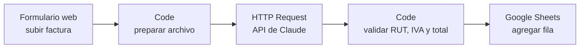

# Facturas a Google Sheets con IA (n8n)

Automatización en **n8n** que recibe una foto o PDF de una factura desde un formulario web, la lee con IA (API de Claude), valida los datos y los agrega como una fila nueva en Google Sheets. Todo eso sin digitar nada a mano.

## Flujo



| Nodo | Qué hace |
|---|---|
| **Formulario: subir factura** | Crea un formulario con un campo para subir JPG, PNG o PDF. Cualquier persona con el link puede enviar documentos. |
| **Preparar archivo** | Convierte el archivo a base64 y arma la petición a la API (imagen o PDF + instrucciones). |
| **Claude: leer documento** | Llama a `api.anthropic.com/v1/messages` y obtiene los datos en JSON. |
| **Validar datos** | Revisa el dígito verificador del RUT, que el IVA sea el 19% del neto, que el total cuadre y que no falten campos. Marca la fila como `OK` o `REVISAR`. |
| **Agregar a Google Sheets** | Agrega la fila a la hoja `Facturas`. |

## Resultado en la planilla

| fecha_carga | archivo | tipo | emisor | rut_emisor | folio | fecha | neto | iva | exento | total | estado | observaciones |
|---|---|---|---|---|---|---|---|---|---|---|---|---|
| 2026-11-17 | factura-los-andes.png | factura | Distribuidora Los Andes SpA | 76.543.210-3 | 18452 | 2026-11-03 | 76160 | 14470 | | 90630 | OK | |
| 2026-11-17 | factura-lacteos-del-sur.png | factura | Lácteos del Sur Ltda. | 76.881.234-9 | 9031 | 2026-11-05 | 61390 | 11900 | | 73290 | REVISAR | IVA no es el 19% del neto (debería ser 11664) |

## Cómo instalarlo

1. **Importa el flujo:** en n8n, entra a *Workflows → Import from File* y elige `workflow.json`.
2. **Configura la API de Claude:** en el nodo *Claude: leer documento*, crea una credencial de tipo **Header Auth** con:
   - Name: `x-api-key`
   - Value: tu API key de Anthropic (`sk-ant-...`)
3. **Prepara la planilla:** crea un Google Sheets con una hoja llamada `Facturas` y esta primera fila de encabezados:
   ```
   fecha_carga	archivo	tipo	emisor	rut_emisor	folio	fecha	neto	iva	exento	total	estado	observaciones
   ```
4. **Conecta Google Sheets:** en el nodo *Agregar a Google Sheets*, conecta tu cuenta de Google y pega el link de la planilla.
5. **Prueba:** abre el nodo del formulario, copia la *Test URL*, sube una de las facturas de ejemplo de la carpeta `ejemplos/` y revisa la planilla.
6. **Actívalo:** activa el flujo y comparte la *Production URL* del formulario con quien envía las facturas.

> Para gastar menos, cambia `MODELO` a `claude-haiku-5-5` dentro del nodo *Preparar archivo*. El límite por archivo es de 5 MB.

## Ideas para ampliarlo

- Cambiar el formulario por un **Gmail Trigger** que procese las facturas que llegan adjuntas por correo.
- Leer la planilla antes de agregar la fila para **detectar duplicados** (mismo RUT y folio).
- Enviar un aviso por correo o Telegram cuando una fila quede en `REVISAR`.

## Tecnologías

n8n · API de Claude (Anthropic) · JavaScript (nodos Code) · Google Sheets

## Autora

**Elizabeth Araya Gallardo**, estudiante de Ingeniería en Informática (AIEP, Valparaíso). Este flujo es la versión automatizada del [Clasificador de facturas con IA](https://github.com/TU-USUARIO/clasificador-facturas-ia). Los datos de ejemplo son ficticios.
